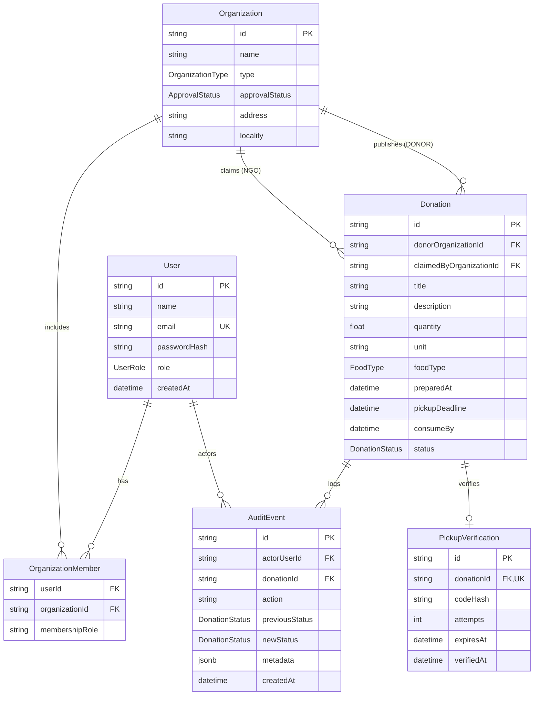

# MealRelay — Surplus Food Recovery & Distribution Coordination Platform

> **Phase 2: Transactional Workflows & Complete Application**  
> Status: Fully Implemented & Tested  
> Target Completion Deadline: October 27, 2026, 11:59 PM IST

---

## 1. Project Overview & Problem Statement

Millions of tons of edible, freshly prepared food from cafeterias, restaurants, messes, and event caterers are discarded daily due to a lack of immediate coordination with community organizations that can redistribute it safely. 

**MealRelay** bridges this gap as a surplus-food recovery and distribution coordination platform. Food donors publish time-limited, verifiable offers of surplus food with explicit preparation times, pickup deadlines, and consumption expiration limits. Approved NGOs and community relief shelters discover, claim, and pick up donations before the food expires.

---

## 2. Target Users & Key Capabilities

1. **Food Donors**:
   - Publish surplus food packages with strict food safety schedules.
   - Manage postings across statuses (`OPEN`, `CLAIMED`, `COMPLETED`, `EXPIRED`, `CANCELLED`).
   - Securely retrieve and display the 6-digit **handover verification code** once claimed.
   - Cancel eligible offers with documented reasons.
   - View database-derived real-time analytics.
2. **Community Relief Organizations (NGOs)**:
   - Discover available surplus food filtered by locality and category.
   - Atomically claim donations with strict race condition prevention.
   - Track active claims and collection reservations.
   - Complete in-person handoffs by submitting the donor's 6-digit verification code.
3. **Platform Administrators**:
   - Review organization authenticity and approval status.
   - Supervise audit logs across the entire recovery lifecycle.

---

## 3. Phase 2 Features Implemented

### A. Atomic Donation Claiming (`POST /api/donations/:id/claim`)
- **Concurrency & Transaction Control**: Handled via PostgreSQL atomic conditional updates within single transactions. When two NGOs simultaneously attempt to claim the same donation, exactly one succeeds and the other receives a clean `409 Conflict`.
- **Preconditions Enforced**: User must belong to an approved NGO; donation must be `OPEN`; pickup deadline must not have passed; donor cannot claim own donation.
- **Atomic Execution**: In one single commit:
  1. Transitions state from `OPEN` to `CLAIMED`.
  2. Sets `claimedByOrganizationId`.
  3. Creates `PickupVerification` record with cryptographic hash.
  4. Records `DONATION_CLAIMED` audit event.
  Failures roll back completely with zero orphaned records.

### B. Secure Pickup Verification Handshake (`POST /api/donations/:id/verify-pickup`)
- **Cryptographic Security**: 6-digit verification code is derived using Node.js HMAC-SHA256 (`crypto`). Only its SHA-256 hash is persisted in PostgreSQL.
- **Zero Information Leakage**: The plaintext code is strictly revealed only to the authorized owning donor via `GET /api/donations/:id/pickup-code`. It is never returned to the claiming NGO, never logged, and never included in audit metadata.
- **Handoff Handshake**: The donor tells the code to the NGO representative in person at collection. The NGO submits it to complete the transaction.
- **Brute-Force & Replay Protection**:
  - Verification attempts are rate-limited (`attempts` tracked in DB; locked after 5 failed attempts).
  - Code comparisons use constant-time `crypto.timingSafeEqual`.
  - Replays of completed codes are rejected with `409 Conflict`.
  - Transitions donation to `COMPLETED` and marks `verifiedAt = NOW()`.

### C. Automated Donation Expiration Worker
- **Background Scheduler**: Powered by `node-cron`, runs periodically in the background (and gracefully stops on server shutdown).
- **Conditional Expiration**: Idempotently finds `OPEN` donations where `pickupDeadline <= NOW()` and conditionally updates them to `EXPIRED`.
- **Integrity Rules**: `CLAIMED` donations are never expired by this job (preserves active reservations). Completed and cancelled donations remain untouched. Running multiple times produces no duplicate transitions or audit events.
- **Testable**: Exported `processExpiredDonations()` function allows direct verification in test suites.

### D. Explicit Cancellation Business Rules (`POST /api/donations/:id/cancel`)
- Owning donor may cancel an `OPEN` donation.
- Owning donor may cancel a `CLAIMED` donation (invalidating the pickup code and recording the reason).
- Claiming NGO may cancel its own `CLAIMED` reservation (invalidating the code and releasing the handoff).
- `COMPLETED`, `EXPIRED`, or already `CANCELLED` donations cannot be cancelled.
- Unrelated organizations cannot cancel another organization's donation.
- Accepts an optional cancellation reason (max 250 characters) recorded in the immutable audit event.

### E. Complete Audit Trail (`GET /api/donations/:id/history`)
- Records all significant transitions: `DONATION_CREATED`, `DONATION_UPDATED`, `DONATION_CLAIMED`, `PICKUP_VERIFIED`, `DONATION_COMPLETED`, `DONATION_CANCELLED`, `DONATION_EXPIRED`.
- Displays an interactive timeline on the donation details page showing timestamps, actors, and notes.

### F. Real Database Dashboards (`GET /api/dashboard/summary`)
- Direct PostgreSQL queries via Prisma aggregations (no in-memory counting).
- **Donor View**: Total Created, Open Offers, Claimed (Awaiting Pickup), Completed Handoffs, Expired, Cancelled.
- **NGO View**: Available in Feed, Active Reservations, Completed Pickups, Cancelled Claims.
- **Accurate Metric Labeling**: A completed handoff is explicitly labeled as a recorded pickup, not proof that the food was consumed.

---

## 4. Technology Stack

| Layer | Technologies |
|---|---|
| **Frontend** | React 19, Vite 8, Tailwind CSS v4, Lucide Icons |
| **Backend** | Node.js (ESM), Express 4, node-cron 3.0.3 |
| **Database & ORM** | PostgreSQL 18, Prisma 5.22.0 |
| **Validation** | Zod 3.24.1 |
| **Authentication & Cryptography** | bcryptjs, jsonwebtoken, crypto (HMAC-SHA256, timingSafeEqual) |
| **Testing** | Vitest 2.1.8, Supertest 7.0.0 |
| **Architecture** | Modular Monolith (separate `client/` and `server/` packages) |

---

## 5. System Architecture & Directory Structure

```text
MealRelay/
├── client/                     # React + Vite Frontend
│   ├── src/
│   │   ├── api/                # Centralized fetch API client
│   │   ├── components/         # Navbar, DonationCard, FilterBar, Pagination, Modals
│   │   ├── context/            # AuthContext (user, organization, token)
│   │   ├── pages/              # Browse, Detail, Create, Login, Register, Dashboard
│   │   ├── App.jsx             # Main layout & router shell
│   │   └── index.css           # Tailwind typography & base styles
│   ├── package.json
│   └── vite.config.js
├── server/                     # Node.js + Express Backend
│   ├── prisma/
│   │   ├── migrations/         # Committed SQL migration history
│   │   ├── schema.prisma       # Prisma schema with 6 entities
│   │   └── seed.js             # Development demo accounts & sample donations
│   ├── src/
│   │   ├── config/             # Environment & Prisma client instances
│   │   ├── middleware/         # Auth, Authorization, Error, NotFound, RateLimiter, Validator
│   │   ├── modules/
│   │   │   ├── audit/          # Audit logging service
│   │   │   ├── auth/           # Registration, login, session endpoints
│   │   │   ├── dashboard/      # Dashboard summary metrics
│   │   │   ├── donations/      # Creation, listing, claim, pickup, cancel, expiry
│   │   │   └── organizations/  # Organization inspection & admin approval
│   │   ├── utils/              # Custom errors, JWT, crypto, bcrypt helpers
│   │   ├── app.js              # Express app definition & route registry
│   │   └── server.js           # Server listen & graceful shutdown handlers
│   ├── tests/                  # Automated Vitest integration tests (46 tests)
│   ├── package.json
│   └── vitest.config.js
├── package.json                # Root development orchestration
├── README.md                   # Complete documentation
└── .gitignore                  # Environment, build, and credentials exclusions
```

---

## 6. Database Entities & Relationships



---

## 7. API Endpoint Reference

### Health & Diagnostics
- `GET /api/health` — System uptime, timestamp, and PostgreSQL health check.

### Authentication (`/api/auth`)
- `POST /api/auth/register` — Register a new user and associated organization (`DONOR` or `NGO`).
- `POST /api/auth/login` — Authenticate and receive a JWT.
- `GET /api/auth/me` — Retrieve current authenticated user and organization profile.

### Donations (`/api/donations`)
- `POST /api/donations` — Create a new surplus food offer (Approved Donors only).
- `GET /api/donations` — Browse open donations or query claims (`page`, `limit`, `locality`, `foodType`, `my`, `claims`).
- `GET /api/donations/:id` — View complete donation details (includes pickup code for owning donor if claimed).
- `PATCH /api/donations/:id` — Edit an `OPEN` donation (Owning Donor only).
- `POST /api/donations/:id/claim` — Atomically claim an open donation (Approved NGOs only).
- `POST /api/donations/:id/verify-pickup` — Submit 6-digit pickup code to complete handoff (Claiming NGO only).
- `POST /api/donations/:id/cancel` — Cancel an eligible donation with optional reason (Donor or Claiming NGO).
- `GET /api/donations/:id/pickup-code` — Securely retrieve the 6-digit handover PIN (Owning Donor only).
- `GET /api/donations/:id/history` — Retrieve immutable audit trail for a donation.

### Dashboard (`/api/dashboard`)
- `GET /api/dashboard/summary` — Role-specific database-derived metrics for Donors, NGOs, and Admins.

### Organizations (`/api/organizations`)
- `GET /api/organizations/:id` — View public organization profile.
- `PATCH /api/organizations/:id/approval` — Update organization approval status (`ADMIN` only).

---

## 8. Local Setup & Execution Guide

### Prerequisites
- **Node.js**: `v20.x` or later (tested on Node v25.0.0)
- **PostgreSQL**: PostgreSQL 14+ installed and running locally on port 5432

### Step 1: Install Dependencies
```bash
npm install
cd server && npm install
cd ../client && npm install
cd ..
```

### Step 2: Database Setup & Migrations
```bash
npm run migrate
npm run seed
```

### Step 3: Start the Application
```bash
npm run dev
```
- Backend runs on: `http://localhost:5000`
- Frontend runs on: `http://localhost:5173`

---

## 9. Development Demo Accounts

The database seed provides 4 ready-to-use demo accounts with 1-click login buttons on the login page:

| Account Type | Email | Password | Organization | Status |
|---|---|---|---|---|
| **Approved Donor** | `donor@demo.org` | `DemoPass123!` | Green Bites Cafe & Mess | `APPROVED` |
| **Approved NGO** | `ngo@demo.org` | `DemoPass123!` | Community Harvest Trust | `APPROVED` |
| **Pending NGO** | `pending.ngo@demo.org` | `DemoPass123!` | Hope Shelter Network | `PENDING` |
| **Administrator** | `admin@demo.org` | `DemoPass123!` | MealRelay Operations Hub | `APPROVED` |

---

## 10. Automated Testing

The automated test suite runs against the dedicated `mealrelay_test` PostgreSQL database using **Vitest** and **Supertest**.

```bash
# Run all tests from the project root
npm run test
```

### Test Suite Results (46 Tests Total, 100% Passing)

```text
 ✓ tests/phase2.test.js (31 tests) 1801ms
   ✓ 1. Approved NGO can claim an OPEN donation
   ✓ 2. Pending NGO cannot claim a donation (403 Forbidden)
   ✓ 3. Donor cannot claim its own donation (403 Forbidden)
   ✓ 4. Unauthenticated claim request is rejected with 401
   ✓ 5. Already-claimed donation returns a 409 Conflict
   ✓ 6. Expired donation cannot be claimed (409 Conflict)
   ✓ 7. Two simultaneous claims from different NGOs result in exactly one winner
   ✓ 8. Failed claim transactions leave no orphaned verification record or audit event
   ✓ 9. Claim creates a valid pickup-verification record in DB
   ✓ 10. Only the authorized donor can access the pickup code
   ✓ 11. Only the NGO holding the claim can verify the code
   ✓ 12. Invalid code is rejected with 400 Bad Request
   ✓ 13. Expired code is rejected with 409 Conflict
   ✓ 14. Successful verification transitions CLAIMED to COMPLETED
   ✓ 15. Replayed verification is rejected with 409 Conflict
   ✓ 16. Concurrent verification attempts cannot complete the donation twice
   ✓ 17. Code hashes and codes never appear in unauthorized responses or audit metadata
   ✓ 18. Expiry job transitions overdue OPEN donations to EXPIRED
   ✓ 19. Expiry job does not expire CLAIMED or COMPLETED donations
   ✓ 20. Running expiry twice does not duplicate events (idempotent)
   ✓ 21. Donor can cancel its eligible OPEN donation
   ✓ 22. Unauthorized cancellation is rejected (403 Forbidden)
   ✓ 23. Cancellation invalidates any outstanding pickup code
   ✓ 24. Completed donations cannot be cancelled (409 Conflict)
   ✓ 25. Invalid status transitions (e.g. editing CLAIMED) are rejected
   ✓ 26. Claim creates exactly one corresponding audit event
   ✓ 27. Completion creates the expected audit event
   ✓ 28. Cancellation and expiration create audit events
   ✓ 29. Unauthorized users cannot access another organization's private history
   ✓ 30. Dashboard counts reflect real persisted records
   ✓ 31. Pagination and organization scoping work correctly for claims and donations

 ✓ tests/api.test.js (15 tests) 1139ms
   ✓ 1. Health endpoint succeeds and verifies database connectivity
   ✓ 2. Registration creates a user with a password hash, not a plaintext password
   ✓ 3. Duplicate email registration is rejected with conflict error (409)
   ✓ 4. Public registration cannot create an ADMIN even if requested
   ✓ 5. Login succeeds with valid credentials and returns safe fields
   ✓ 6. Login fails with invalid credentials (401)
   ✓ 7. Unauthenticated donation creation is rejected with 401
   ✓ 8. A non-donor (NGO) cannot publish a donation (403)
   ✓ 9. Invalid quantity (<= 0) and invalid timestamps are rejected with 400
   ✓ 10. An approved donor can create a donation with status OPEN and audit log
   ✓ 11. A user cannot modify another organization's donation (403)
   ✓ 12. An unauthorized user cannot view private non-open donation details (403)
   ✓ 13. Pagination and filters behave correctly
   ✓ 14. Invalid JSON produces a controlled error response with code INVALID_JSON (400)
   ✓ 15. Owning donor can update OPEN donation, but cannot edit non-OPEN donation

Test Files: 2 passed (2)
Tests:      46 passed (46)
Duration:   4.92s
```

---

## 11. Phase 3 Roadmap

Deferred features for future development phases:
- Automated push notifications or SMS alerts upon donation claim and expiration warnings.
- Geolocation-based distance sorting and route calculation.
- Advanced administrative verification consoles with document uploads.
- Community feedback, rating, and organization reliability scoring.
